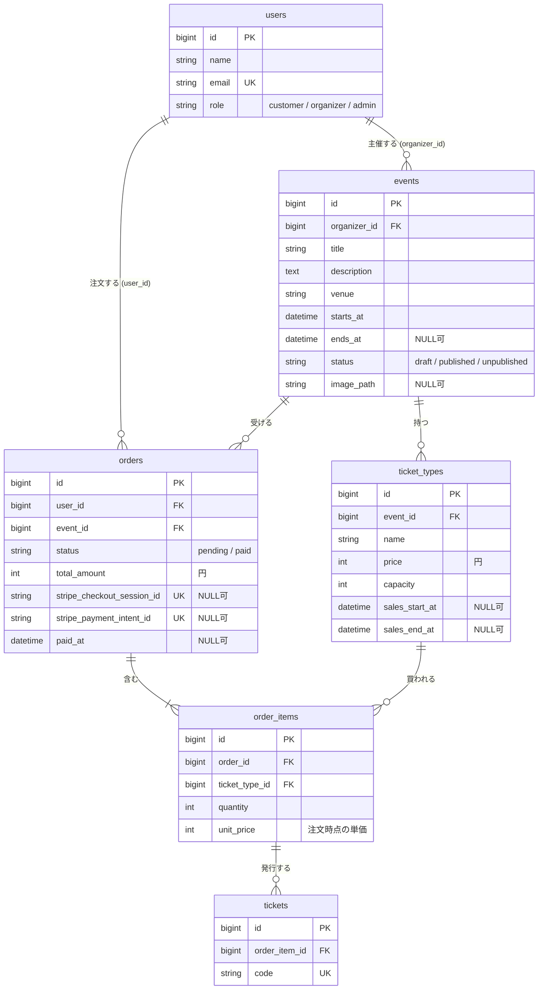

# データベース設計

ユーザーストーリーと画面一覧（`doc/design/screens.md`）をもとにしたテーブル設計。

前提（仕様書 `doc/spec/04_flows_tests_seed.md` の決め事を含む）:

- イベントの状態は `draft` / `published` / `unpublished`（管理者が非公開にしたもの）
- 支払い済みの注文があるイベントは削除できない（T5）
- Webhook と完了ページが二重に処理してもチケットを二重発行しない。`pending` のときだけ `paid` に更新する（T11）
- 残り枚数はカラムに持たず、注文から計算する（「残り枚数の計算」を参照）

<br>

## ER 図



<br>

## カラム定義

全テーブルに `id`（bigint, PK）と `created_at` / `updated_at` がある（表では省略）。

状態のカラムは DB の enum 型ではなく `string` にし、PHP の Enum（`UserRole`、`EventStatus`、`OrderStatus`）でキャストする。値を増やすとき（E3 の `refunded` など）にマイグレーションが要らないため。

### users（既存テーブルに追加）

| カラム | 型 | 制約 | 説明 |
|-|-|-|-|
| role | string(20) | NOT NULL, default `customer`, index | `customer` / `organizer` / `admin` |

### events

| カラム | 型 | 制約 | 説明 |
|-|-|-|-|
| organizer_id | foreignId | NOT NULL, FK → users.id, restrict | 主催者 |
| title | string(100) | NOT NULL | イベント名 |
| description | text | NOT NULL | 説明 |
| venue | string(100) | NOT NULL | 会場 |
| starts_at | datetime | NOT NULL | 開始日時 |
| ends_at | datetime | NULL 可 | 終了日時 |
| status | string(20) | NOT NULL, default `draft` | `draft` / `published` / `unpublished` |
| image_path | string | NULL 可 | 画像のパス（E14 で使う。先に用意しておく） |

インデックス: `(status, starts_at)`（公開中で開催前のイベントを、開催日が近い順に出す一覧用）

### ticket_types

| カラム | 型 | 制約 | 説明 |
|-|-|-|-|
| event_id | foreignId | NOT NULL, FK → events.id, cascade | イベント |
| name | string(50) | NOT NULL | 券種名（一般、学生 など） |
| price | unsignedInteger | NOT NULL | 価格（円）。0 は無料券 |
| capacity | unsignedInteger | NOT NULL | 定員 |
| sales_start_at | datetime | NULL 可 | 販売開始。NULL ならすぐ販売 |
| sales_end_at | datetime | NULL 可 | 販売終了。NULL ならイベント開始まで |

### orders

| カラム | 型 | 制約 | 説明 |
|-|-|-|-|
| user_id | foreignId | NOT NULL, FK → users.id, restrict | 注文者 |
| event_id | foreignId | NOT NULL, FK → events.id, restrict | 対象イベント。1注文 = 1イベント |
| status | string(20) | NOT NULL, default `pending` | `pending` / `paid` |
| total_amount | unsignedInteger | NOT NULL | 合計金額（円）。明細の合計を注文時に保存 |
| stripe_checkout_session_id | string | NULL 可, unique | Checkout Session の ID。0円注文と作成直後は NULL |
| stripe_payment_intent_id | string | NULL 可, unique | 支払いの PaymentIntent の ID。`paid` にしたときに保存する（返金で使う） |
| paid_at | datetime | NULL 可 | 支払いが確定した日時 |

インデックス: `(event_id, status)`（売上集計・残り枚数の計算用）、`(user_id, created_at)`（マイページ用）

### order_items

| カラム | 型 | 制約 | 説明 |
|-|-|-|-|
| order_id | foreignId | NOT NULL, FK → orders.id, cascade | 注文 |
| ticket_type_id | foreignId | NOT NULL, FK → ticket_types.id, restrict | 券種 |
| quantity | unsignedSmallInteger | NOT NULL | 枚数（1以上。アプリでバリデーション） |
| unit_price | unsignedInteger | NOT NULL | 注文時点の単価（円）。券種の価格が後で変わっても変えない |

ユニーク: `(order_id, ticket_type_id)`（同じ注文で同じ券種は1行にまとめる）

### tickets

| カラム | 型 | 制約 | 説明 |
|-|-|-|-|
| order_item_id | foreignId | NOT NULL, FK → order_items.id, cascade | どの明細から発行されたか（券種と注文はここからたどる） |
| code | string(26) | NOT NULL, unique | チケット固有のコード。ULID（`Str::ulid()`）で生成 |

<br>

## 外部キーの削除時の動き

| 外部キー | 動き | 理由 |
|-|-|-|
| events.organizer_id → users | restrict | 主催者を消すとイベントと売上が消えてしまう。イベントがある主催者はアカウント削除できない |
| ticket_types.event_id → events | cascade | 券種はイベントの一部。売れた券種は order_items の restrict で守られる |
| orders.user_id → users | restrict | 支払いの記録を残すため。注文がある利用者はアカウント削除できない |
| orders.event_id → events | restrict | 注文があるイベントは DB レベルで消せない。アプリ側は「`paid` の注文が無ければ、`pending` の注文を消してからイベントを消す」をトランザクションで行う（T5） |
| order_items.order_id → orders | cascade | 明細は注文の一部 |
| order_items.ticket_type_id → ticket_types | restrict | 売れた券種を消すと明細の意味が無くなる |
| tickets.order_item_id → order_items | cascade | チケットは明細の一部（`paid` の注文は消せないので、実際には消えない） |

注意: 既存の「アカウント削除」画面（`resources/views/pages/settings/⚡delete-user-*`）は、イベントや注文がある利用者では外部キーエラーになる。エラーメッセージを出す対応は別の機能として扱う。

<br>

## 残り枚数の計算

券種ごとの残り枚数は、カラムに保存せず、表示や購入チェックのたびに注文から計算する。

```
残り枚数 = ticket_types.capacity
         − ( status = paid の注文の order_items.quantity の合計
           + status = pending で、作成から31分以内の注文の order_items.quantity の合計 )
```

- `pending` も数えるのは、支払い画面に進んだ人の分を押さえておくため
- 作成から31分を過ぎた `pending` は数えない。支払いを放置した注文の分は、時間がたつと自動で売り物に戻る
- 31分は設定値として1か所にまとめる（`config/tickets.php` の `pending_hold_minutes`）
- 31分にするのは、Stripe の決済ページの期限（`expires_at`）が最短30分のため。決済ページは枠の確保が切れる30秒前に閉じ、枠が戻ったあとに払われないようにする

### カラムに持たない理由

`ticket_types.remaining` のようなカラムを作ると、注文と残り枚数の2か所に同じ情報を持つことになり、次の場面で数がずれる。

| 場面 | ずれ方 |
|-|-|
| `pending` が31分を過ぎる | 時間がたつだけでは何も更新されないので、減ったまま戻らない |
| 定員の変更、注文の削除、返金（E3） | 更新する場所が多く、1か所でも漏れるとずれたままになる |
| 同時に購入される | 2人が同じ残り枚数を読んで書き込み、片方の減算が消える |
| Webhook の再送 | 同じ支払いで2回減らしてしまう |

計算で出せば元のデータは注文だけなので、これらの更新漏れが起きない。集計の速さは `orders` の `(event_id, status)` インデックスで補う。

同時購入で定員を超える問題は、計算方式でも「チェックしてから注文を作るまで」の間に起こり得る。これは拡張 E2（トランザクションと行ロック）で対策する。
