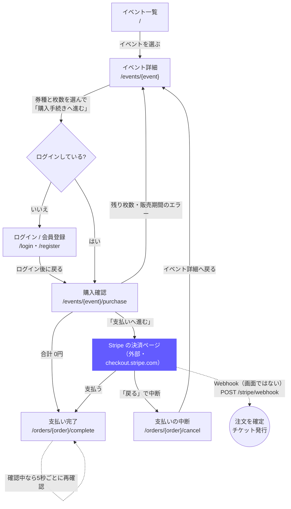

# 画面一覧

ユーザーストーリーを実現するための画面。URL は `doc/spec/04_flows_tests_seed.md` の決め事に合わせる。  
括弧内の番号は `doc/spec/01_requirements.md` の機能一覧に対応する。

 

## Day4（講義中に作る範囲）

| 画面名 | URL | ログインが必要か | 使えるロール | 表示するもの・できること |
|-|-|:-:|-|-|
| 会員登録 | `/register` | 不要 | 誰でも | 名前・メール・パスワードと「主催者として登録」の選択（C1）。既にある画面にロールの選択を追加する |
| ログイン / パスワードリセット | `/login`、`/forgot-password` | 不要 | 誰でも | 既にある（Fortify）。変更なし |
| イベント一覧（トップ） | `/` | 不要 | 誰でも | 公開中で終了前（開催中を含む）のイベントを開催日が近い順に表示（C3）。終了日時が無いものは開始前まで。下書きは出さない |
| イベント詳細 | `/events/{event}` | 不要（購入はログインが必要） | 誰でも | 日時・会場・説明、券種ごとの価格・残り枚数・販売期間（C4）。券種と枚数を選んで購入確認へ進む（C8）。売り切れ・販売期間外はエラー表示（C9）。下書きは主催者本人以外は 404 |
| 主催者ダッシュボード | `/organizer/events` | 必要 | 主催者 | 自分のイベントの一覧と公開状態（C15）。新規登録・編集へのリンク |
| イベント登録 | `/organizer/events/create` | 必要 | 主催者 | タイトル・日時・会場・説明を入力して下書きで保存（C5） |
| イベント編集 | `/organizer/events/{event}/edit` | 必要 | 主催者（本人のみ） | イベントの編集・削除（C5）、券種の追加・編集・削除（C6）、下書き / 公開の切り替え（C7）。他人のイベントは 403（C2） |

 

## 平日課題

| 画面名 | URL | ログインが必要か | 使えるロール | 表示するもの・できること |
|-|-|:-:|-|-|
| 購入確認 | `/events/{event}/purchase` | 必要 | ログインユーザー | 選んだ券種・枚数と合計金額の確認。「支払いへ進む」で残り枚数と販売期間を再チェックして注文（`pending`）を作り、Stripe Checkout へ移る。合計 0円なら Stripe を通さず支払い完了へ（C8・C10） |
| Stripe Checkout | （Stripe 側のページ） | 必要 | ログインユーザー | 購入確認で作った注文から Stripe の決済ページへ移り、カードで支払う（C10）。自分では作らない |
| 支払い完了 | `/orders/{order}/complete` | 必要 | 注文者本人 | 「購入が完了しました」とイベント・券種・枚数・合計金額。注文詳細へのリンク（C13） |
| 支払いキャンセル | `/orders/{order}/cancel` | 必要 | 注文者本人 | 支払いを中断したことを表示し、イベント詳細へ戻るリンク（C13） |
| 注文一覧（マイページ） | `/orders` | 必要 | ログインユーザー | 自分の注文をイベント名・日時・合計金額・状態つきで一覧（C14） |
| 注文詳細 | `/orders/{order}` | 必要 | 注文者本人 | 注文の内容と発行されたチケットの一覧。当日受付で見せる（C14） |
| イベントの注文・売上 | `/organizer/events/{event}/orders` | 必要 | 主催者（本人のみ） | そのイベントの注文一覧と売上合計（C16） |

画面ではないもの（平日）: Webhook `POST /stripe/webhook`（C11）、購入完了メール（C12）

 

## 画面遷移（購入の流れ）

参加者がイベントを見つけてチケットを買い終わるまで。紫の箱は外部（Stripe）のページ、点線は画面の移動ではない動き。

- 「購入手続きへ進む」はログインしていなくても押せる。購入確認はログインが必要なので、ログイン画面を通ってから、選んだ券種と枚数のまま購入確認に戻る
- 合計 0円の注文は Stripe を通さず、その場で支払い済みにして支払い完了へ進む
- 支払いの確定は、Webhook と支払い完了ページのどちらか早いほうで行う（「pending のときだけ」の条件付き更新で二重にならない）
- 注文一覧（マイページ）・注文詳細は平日課題の後半（任意）で追加する

 

## 補足

- 主催者ダッシュボードは、既にある `/dashboard` ではなく `/organizer/events` にする。ロールによって中身が変わる画面を避けるため
- 管理者画面（E15）と画像アップロード（E14）は拡張なので含めない

### 参考解答（画面設計）との違い

- 購入確認を挟む: 詳細では選ぶだけにし、注文は購入確認で作る。合計金額を確かめてから支払いに進めるのと、詳細を開いたまま時間がたっても、注文を作る直前の残り枚数で売り過ぎを防げるため（参考解答の S5 と同じ）
- トップは終了前まで表示する（参考解答は開催前まで）: 開催中のイベントや複数日にわたるイベントも、当日に探せるようにするため
- 主催者ダッシュボードには売上を出さない（参考解答は販売枚数・売上合計も出す）: 売上は「イベントの注文・売上」の画面にまとめるため
- プロフィール設定など、スターターキットに既にあって変更しない画面は一覧で省いている（参考解答は S16 として載せている）
- 画面遷移図は購入の流れだけ。参考解答は主催者・管理者を含む全体図。0円の注文と Webhook は、実装に合わせて自分の図にだけ描いている
